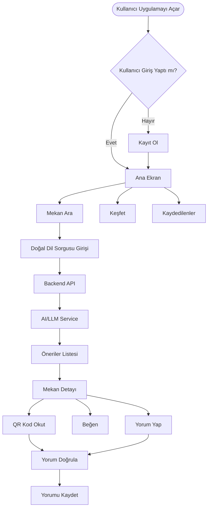
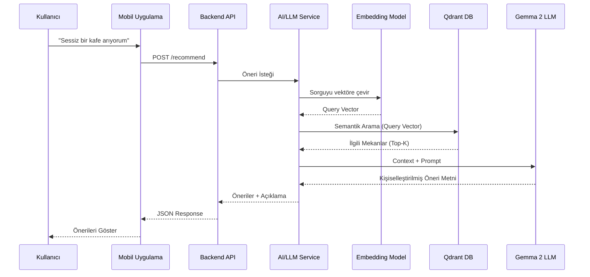
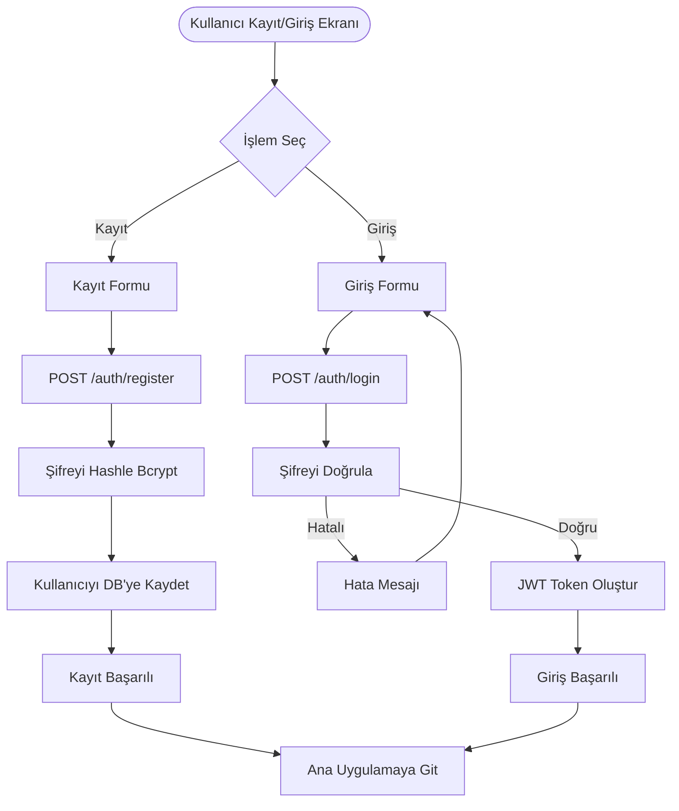
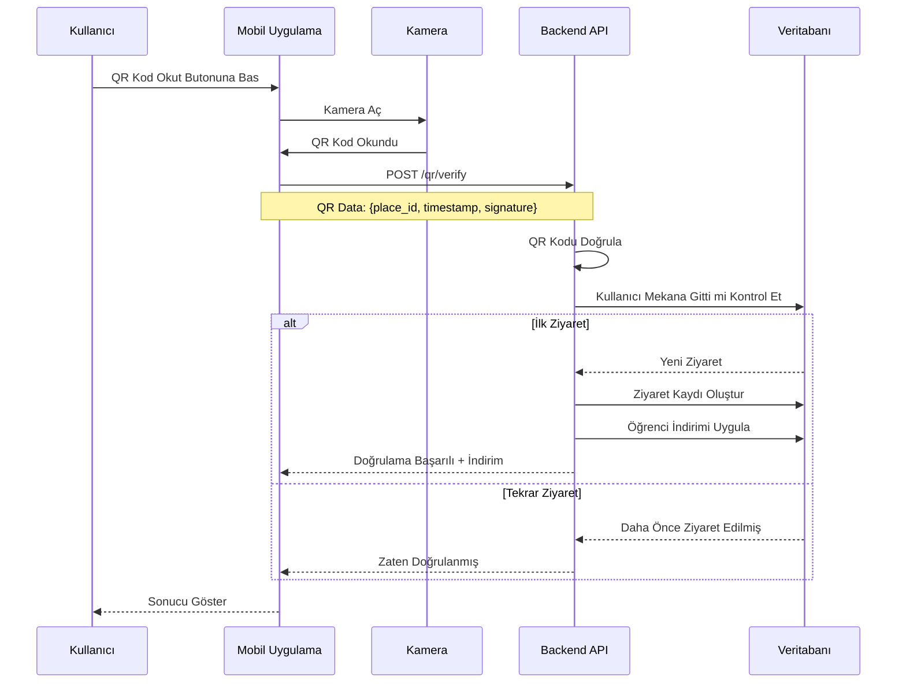
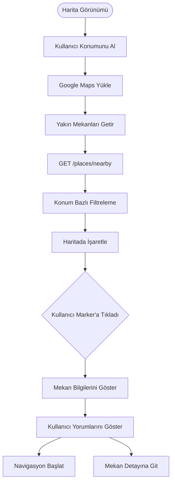
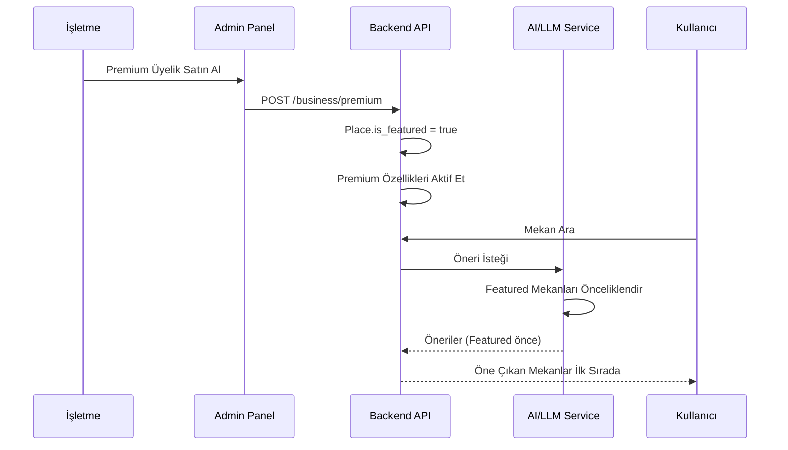
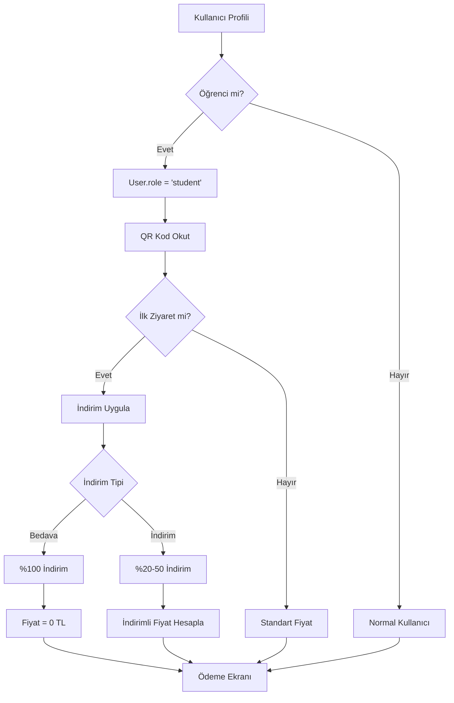
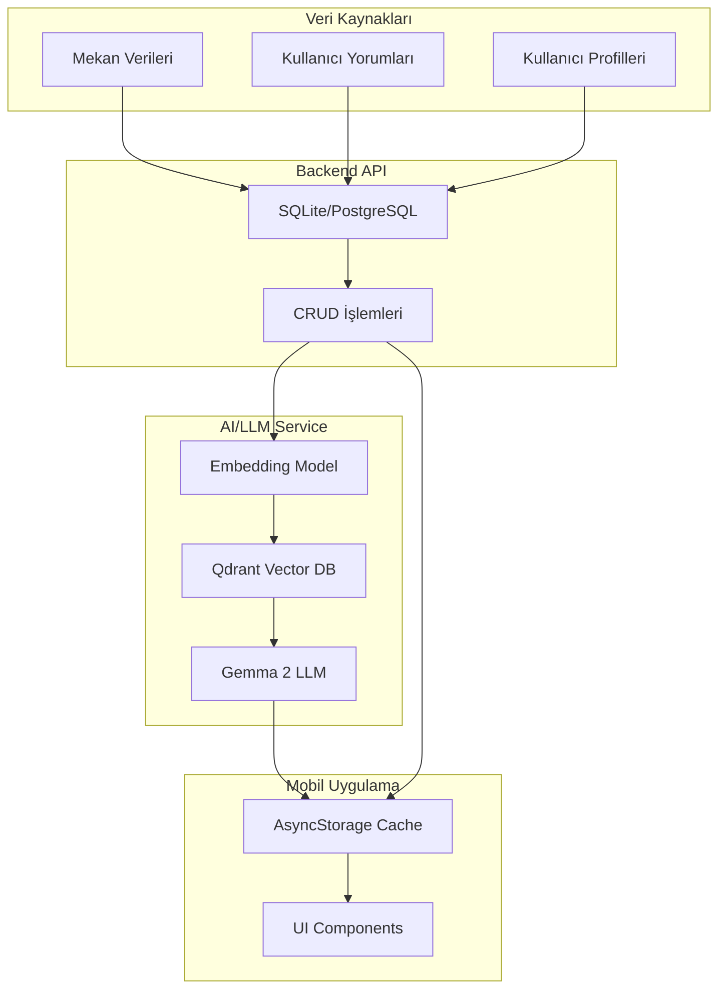
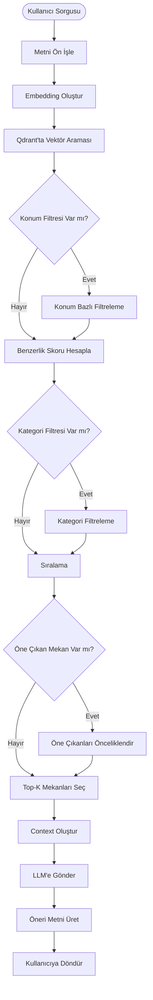
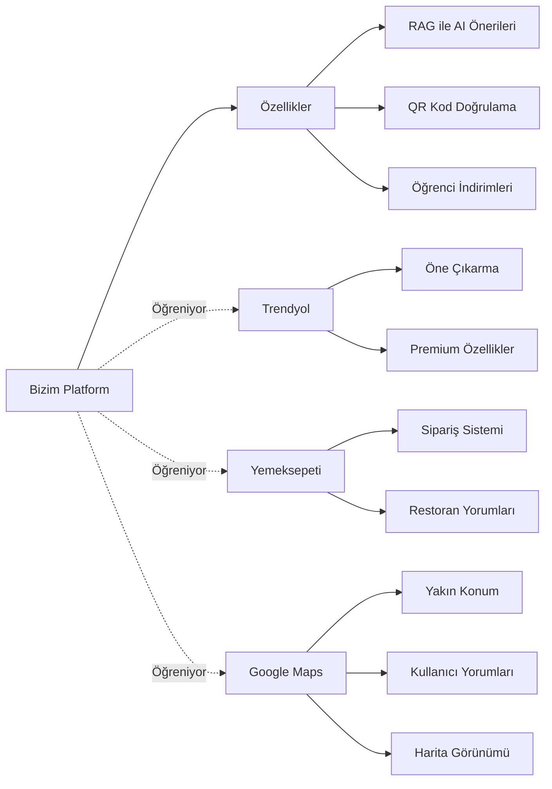

# Proje Akış Diyagramları

Bu doküman, Yapay Zeka Destekli Konum Bazlı Kişiselleştirilmiş Mekan Öneri Platformu'nun tüm akış diyagramlarını içermektedir.

---

## 1. Genel Sistem Akışı



---

## 2. RAG Pipeline Akışı



---

## 3. Kullanıcı Kayıt ve Giriş Akışı



---

## 4. QR Kod Doğrulama Akışı



---

## 5. Yorum ve Beğeni Sistemi Akışı

```mermaid
flowchart LR
    A[Mekan Detay Sayfası] --> B{Yorum Yap}
    A --> C{Beğen}
    
    B --> D[Yorum Formu]
    D --> E{QR Kod Doğrulandı mı?}
    E -->|Evet| F[Doğrulanmış Yorum]
    E -->|Hayır| G[Doğrulanmamış Yorum]
    F --> H[POST /reviews/ is_verified=true]
    G --> I[POST /reviews/ is_verified=false]
    H --> J[Yorum Kaydedildi]
    I --> J
    
    C --> K[Beğeni Butonu]
    K --> L{Beğenildi mi?}
    L -->|Evet| M[POST /places/{id}/like]
    L -->|Hayır| N[DELETE /places/{id}/like]
    M --> O[Beğeni Sayısı Artır]
    N --> P[Beğeni Sayısı Azalt]
    O --> Q[Güncelle]
    P --> Q
```

---

## 6. Google Maps Entegrasyonu Akışı



---

## 7. Trendyol Öne Çıkarma Sistemi Akışı



---

## 8. Öğrenci İndirim Sistemi Akışı



---

## 9. Veri Akış Diyagramı



---

## 10. Öneri Algoritması Detaylı Akışı



---

## 11. Pazar Araştırması - Rekabet Analizi



---

## Notlar

- Tüm diyagramlar Mermaid formatındadır ve GitHub, GitLab veya Mermaid destekleyen platformlarda otomatik render edilir.
- Diyagramlar proje geliştikçe güncellenecektir.
- Detaylı teknik dokümantasyon için ilgili kod dosyalarına bakınız.
